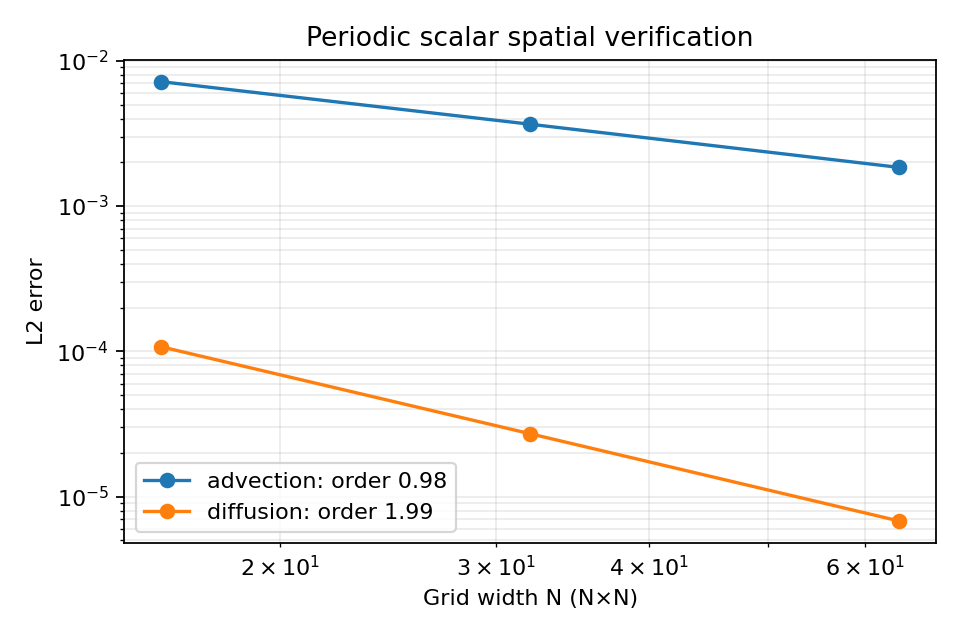
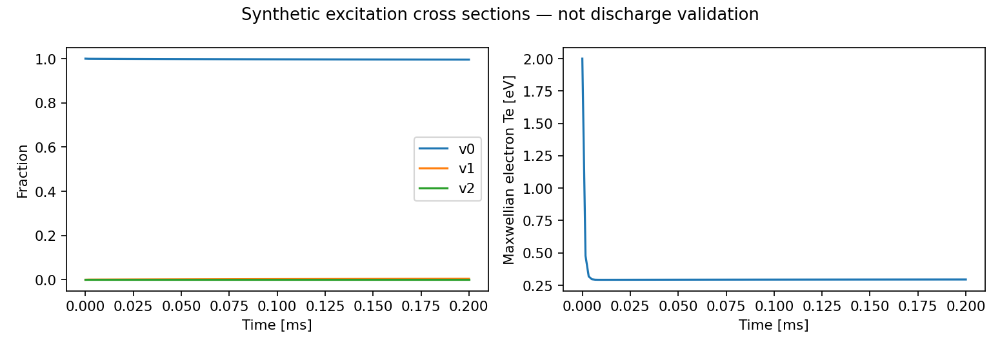

# PlasmaROM-H2

**Numerical kinetics, energy-aware model-reduction and reactive-transport research prototype**  
Python · SciPy · NumPy · Cantera (optional) · Boltzmann EEDF (optional)

> **Scope:** This is an independent, AI-assisted educational computational prototype. It is **not** a validated plasma-assisted ammonia/hydrogen combustion solver, a published P-DRGEP implementation, a DNS/LES solver, or an experimentally verified prediction system. Source code and numerical verification are included; the optional external Cantera/Boltzmann integrations were not executed in the environment used to prepare this release.

## What is included

| Module | Capability | Evidence / limitation |
| --- | --- | --- |
| `plasmarom/kinetics.py`, `flow.py` | Reduced state kinetics and two-dimensional numerical transport | Synthetic models, numerical unit tests |
| `plasmarom/verification.py`, `reactive_transport_1d.py` | Conservation and spatial-convergence checks | Numerical verification, not experiment |
| `plasmarom/plasma_states.py`, `electron_energy.py` | Three-level H₂ demonstrator and electron-energy accounting | Spectroscopic level energies; synthetic collision cross sections |
| `plasmarom/energy_graph.py`, `channel_reduction.py` | Energy-aware channel screening with separate electron loss and gain retention | Toy/synthetic data; **not** plasma P-DRGEP |
| `plasmarom/ammonia_h2.py` | Optional Cantera NH₃/H₂/CO zero-dimensional reactor | Mechanism adapter; **not run locally**, no plasma coupling |
| `plasmarom/cantera_boltzmann.py` | Optional Cantera two-term Boltzmann EEDF using Phelps N₂/O₂ example | Integration requires Cantera 3.2+; not an NH₃/H₂ EEDF |
| `plasmarom/cantera_demo.py`, `acceptance.py` | Candidate skeletal mechanism generation and strict evidence checks | Genuine acceptance requires Cantera, replay and meeting fixed tolerances |
| `plasmarom/experiment_compare.py` | Measured-vs-predicted comparison with duplicate detection | External measurements **not** provided or authenticated |

## Quick start (no Cantera required)

Python 3.10 or newer is required.

```bash
python3 -m venv .venv
source .venv/bin/activate
python -m pip install -e '.[test]'
python -m pytest -q tests/test_v12_regressions.py
python -m plasmarom verify --out results_local/verify
python -m plasmarom transport-1d --out results_local/transport
python -m plasmarom channel-reduce --out results_local/channels
```

These commands run numerical and **synthetic** demonstrations. `results_local/` is ignored by Git.

## Optional real chemistry (external dependency)

In an internet-connected environment with Cantera 3.2+:

```bash
python -m pip install -e '.[test,cantera]'
python -m plasmarom ammonia-h2 --out results_local/ammonia
python -m plasmarom boltzmann --out results_local/boltzmann
```

The ammonia example uses the externally distributed Alzueta NH₃/CO/H₂ mechanism. The Boltzmann example uses the Phelps N₂/O₂ plasma example; **the two are not coupled**. Check that both mechanisms are available in the installed Cantera distribution. Do not report runs or physical conclusions unless the commands finish and you inspect their outputs.

To try skeletal H₂/O₂ mechanism screening and separately enforce the stringent numerical acceptance gate:

```bash
python -m plasmarom skeletal --protocol v10_h2o2_default --mechanism h2o2.yaml --out results_local/skeletal
python -m plasmarom assess-skeletal --out results_local/skeletal
```

The acceptance command is designed to **exit nonzero** when a reduced mechanism has not met the pinned protocol. This is an expected scientific result, not proof of a faulty installation.

## Example numerical figures



*Spatial-convergence check (numerical demonstration; not a plasma/combustion experiment).*



*Electron energy in a simplified model using synthetic collision data; not an experimentally measured EEDF.*

## Tests and scientific status

- **Publish-preparation fast suite:** 160 passed, 6 skipped (optional Cantera integrations), 2 deliberately deselected slow multiprocessing checks. This is **not** a claim that the optional chemistry integrations or excluded slow checks passed. Historical v12 verification (143 passed in a different selection) is preserved separately.
- Cantera-dependent integration tests were skipped locally. There is **no verified Cantera reactor / Boltzmann output** in this release.
- GitHub Actions separates routine regression checks, the real-chemistry integration workflow and the manually triggered strict scientific acceptance workflow. A green CI check is **not** a certificate of experimental or physical validity.

Read [Verification v12](docs/history/VERIFICATION_V12.md), [Current gaps](docs/GAP_STATUS_V12.md), [Reproducibility](docs/REPRODUCIBILITY.md), [GitHub release checks](docs/GITHUB_RELEASE_CHECK.md), and [Scientific limitations](docs/SCIENTIFIC_SCOPE.md).

## Repository layout

```text
plasmarom/      Python package and pinned reduction protocols
examples/       Small run scripts, synthetic inputs, explicit schemas
protocols/      Reproducibility copies of evaluation protocols
tests/          Regression, falsification, optional integration tests
results_v*/     Historical numerical output snapshots and test logs
docs/           Scope, reproducibility, earlier release/verification history
.github/        CI, optional real chemistry, strict scientific acceptance
```

**Dependencies and reproducibility:** `pyproject.toml` specifies allowed ranges. `requirements-tested-numerical.txt` records versions observed in an earlier local numerical environment, **not** a complete dependency lock. See `docs/REPRODUCIBILITY.md`.

## Sources and attribution

- [Cantera documentation](https://cantera.org/) for reactor, skeletal-mechanism and two-term EEDF interfaces.
- [Cantera example-data repository](https://github.com/Cantera/cantera-example-data) for the NH₃/CO/H₂ Alzueta and Phelps N₂/O₂ examples (not redistributed here).
- [LXCat](https://nl.lxcat.net/) for independently sourced collision data (no such measured data are bundled with this prototype).

**License:** [MIT](LICENSE). **Author:** Sana Tat. Cite the project using [CITATION.cff](CITATION.cff). See [Contributing](CONTRIBUTING.md) for scientific integrity requirements.
