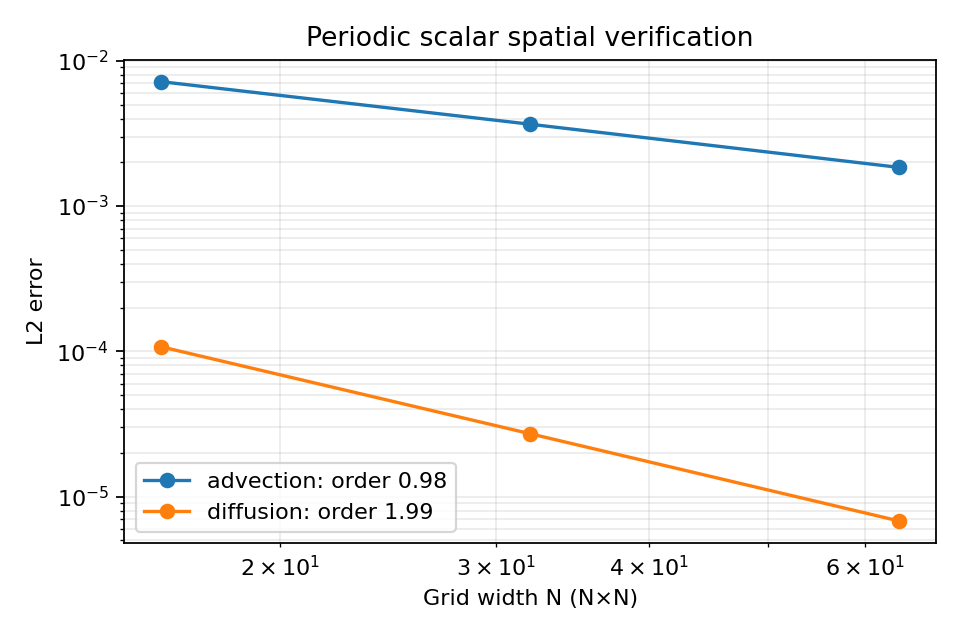
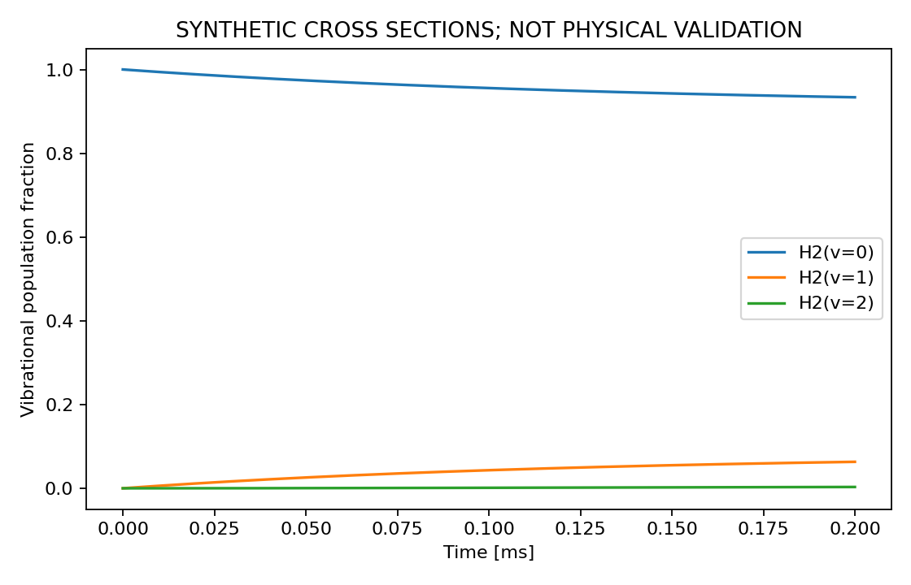
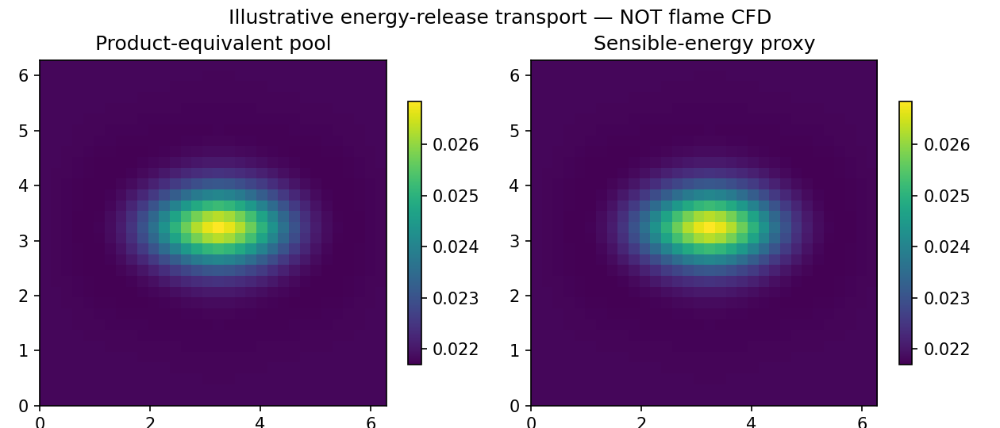
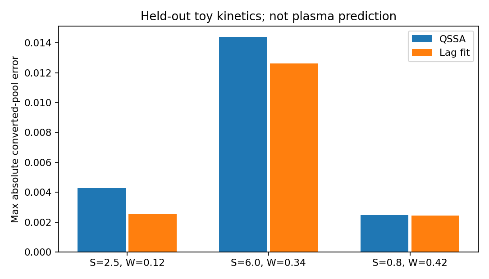

# PlasmaROM-H2 v0.4 — computed verification report

> Automatically built from code execution. A numerical verification is not physical validation.

## Spatial verification
- Periodic upwind advection observed order: **0.980** (target ≈1).
- Centered diffusion observed order: **1.991** (target ≈2).

## Three-level H2 vibrational balance
- Data status: **SYNTHETIC CROSS SECTIONS; NOT PHYSICAL VALIDATION**.
- Energy levels E(v=0,1,2) [eV]: [0.0, 0.5159209294900446, 1.002661446372065].
- Population closure: 3.775e-15.
- Relative electron/vibrational/gas-energy residual: 3.703e-13.
- Assumed Maxwellian EEDF and invented excitation cross sections are **not** calibrated plasma physics.

## Dimensionless heat source + transport
- Mean chemical+sensible energy proxy drift: 0.000e+00.
- Maximum local species-sum drift: 8.882e-16.
- Not physical enthalpy or reacting flow with variable density.

## Fitted QSSA lag correction
- Fitted dimensionless lag: 0.00836182.
- Held-out cases were not used for parameter tuning:
| Pulse strength | Pulse width | Max product error QSSA | Max product error lag |
|---:|---:|---:|---:|
| 2.5 | 0.12 | 0.00429151 | 0.00256731 |
| 6 | 0.34 | 0.0144096 | 0.0126207 |
| 0.8 | 0.42 | 0.00246159 | 0.00243207 |

## Optional chemistry status
- The Cantera skeletal mechanism builder is implemented but was **not executed** in this environment.
- Do not state an actual reduced species count, validated ignition delay, or Cantera speedup.

## Limitations
- No measured electron-impact cross sections supplied.
- No electric field, E/N, Boltzmann EEDF, ionization or charge conservation.
- No validated P-DRGEP or state-to-state combustion mechanism.
- No real flame CFD, 3D DNS/LES, or experimental comparison.
- Small serial CPU timing is not an HPC scaling study.

