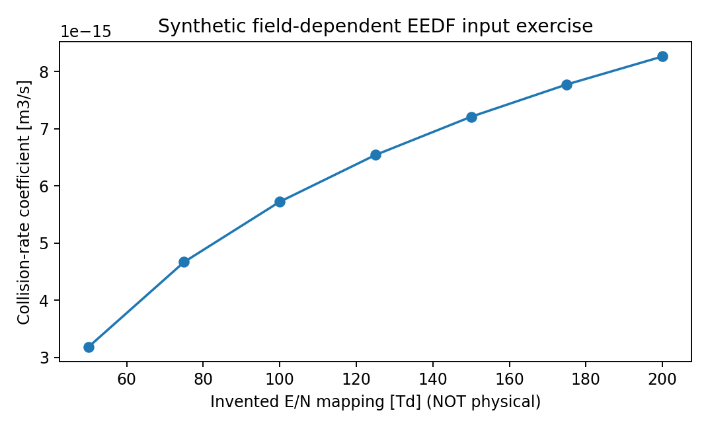
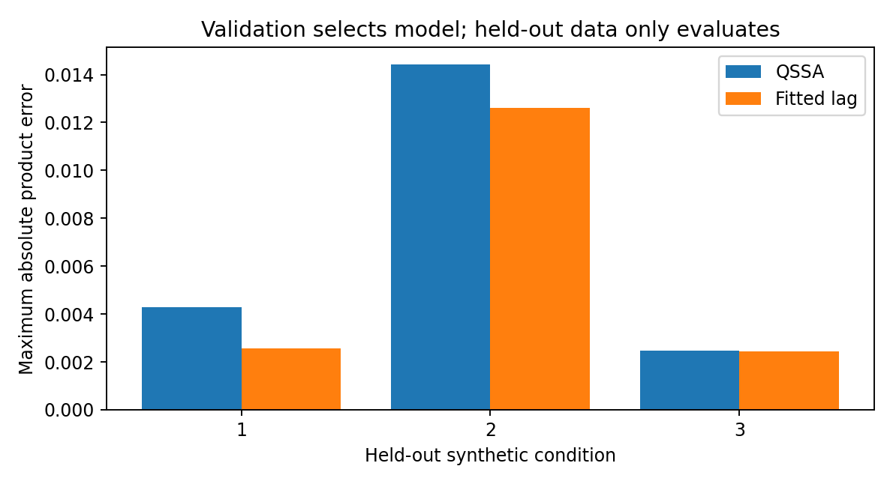

# PlasmaROM-H2 v0.6 — independently reproduced numerical evidence

**Local suite:** 77 passed, 0 failed, 2 optional Cantera tests skipped; 29.54 seconds. Python 3.13.5. See `pytest_v6.txt`.

### Imported EEDF over an invented reduced-field grid

- Target E/N: 100.0 Td (arbitrarily mapped to synthetic Maxwellian distributions).
- Rate coefficient: **5.7214861e-15 m³/s** (not physical experimental H₂ rate).
- Source states: 50 and 200 Td; interpolation in log(E/N), no extrapolation.
- All source files and hashes documented in `field_dependent_rate.json`.

### Toy model-selection safeguard

- Selected **lag_fit** based on independent validation, before held-out evaluation.
- Fitted lag: 0.008362 dimensionless.
- Held-out maximum product errors, lag vs baseline QSSA:

| Held-out case | Lag | QSSA |
|---|---:|---:|
| 1 | 0.002567 | 0.004292 |
| 2 | 0.012621 | 0.014410 |
| 3 | 0.002432 | 0.002462 |

### Repeated local independent-task scaling

- 1 worker(s): median 1.525 s over 2 repetitions, speedup 1.000×.
- 2 worker(s): median 2.272 s over 2 repetitions, speedup 0.671×.

This tests independent 0D task batches only, not MPI, OpenMP, GPU, DNS/LES or HPC scalability. A speedup below 1 means the parallel implementation is slower in this experiment.

### **Not verified** (mandatory disclosure)

Cantera is not available in the local container; all Cantera real reactor, skeletal reduction and 1D flame steps remain optional and **unverified**. Positive synthetic ODE tests do not imply physical plasma discharge validation, agreement with measured ignition, published P-DRGEP, variable-density combustion CFD or experimental confirmation.

The new acceptance checker itself has passing **unit tests**, including false-acceptance rejection, but this is distinct from *passing a real Cantera numerical acceptance run*.
